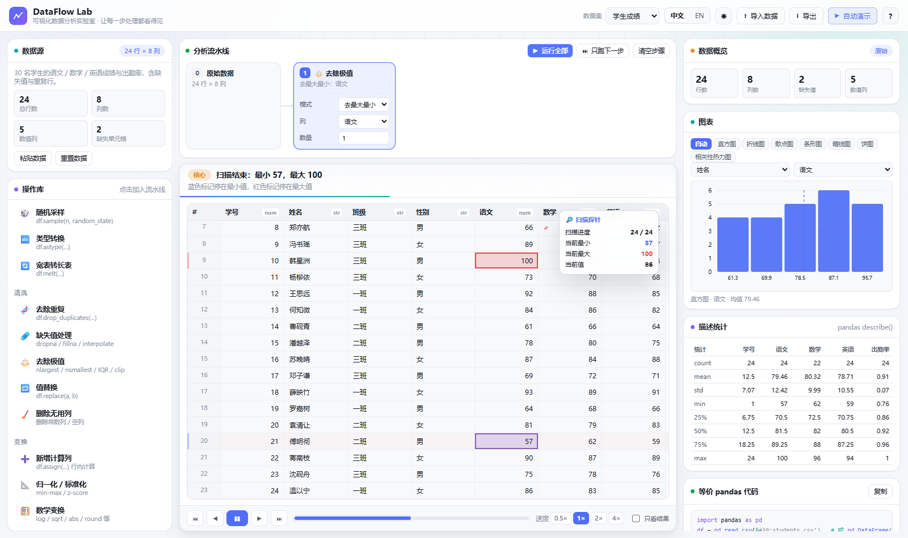
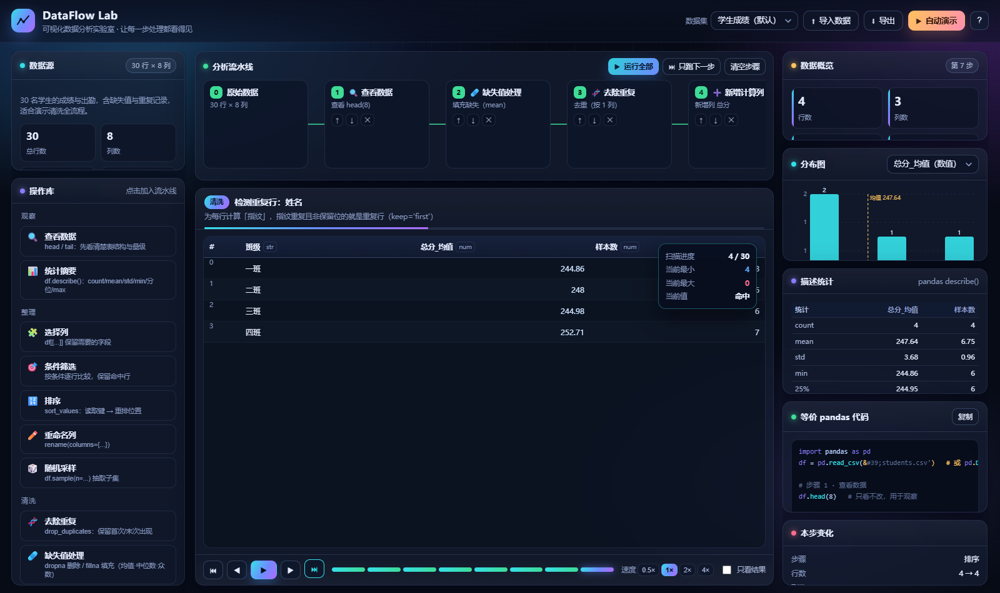
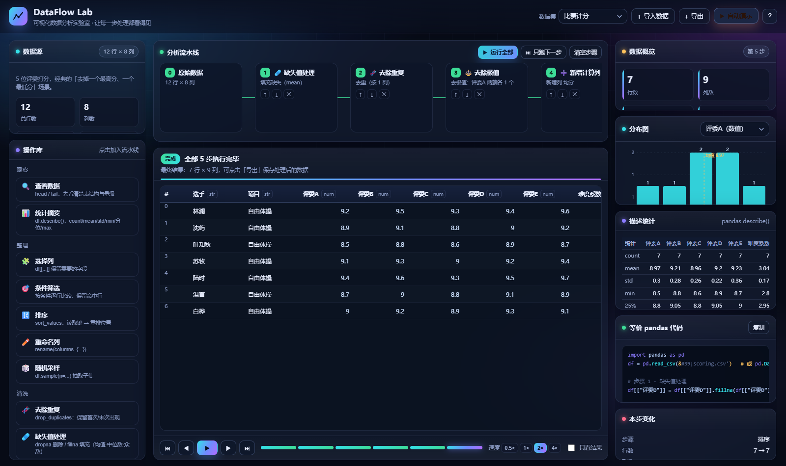

# DataFlow Lab · 关键亮点说明文档

> 数据可视化作业 · 数据分析展示
> 网站名称：**DataFlow Lab（可视化数据分析实验室）**
> 在线地址：<https://wangling1206.github.io/dataflow-lab/>
> 一句话定位：**把 pandas 的每一步处理「演」出来**——不止给结果，而是完整呈现数据从原始状态到处理完成的内部逻辑。

---

## 一、作业要求 → 实现对照

| 作业要求 | 本网站的落实方式 |
|---|---|
| 能自由加载数据并处理 | ① 4 个内置数据集随时切换；② 本地导入 `.csv/.tsv/.txt/.json`；③ 弹窗**粘贴**数据；④ 处理结果可导出 CSV |
| 设定一个默认数据集 | 打开即载入「学生成绩」数据集（30 行 × 8 列，刻意内含 2 个缺失值、1 组重复行、1 个超高分，便于演示清洗） |
| 参考 pandas 以可视化方式实现各种功能 | 13 个操作覆盖 `head/tail/sample`、`describe`、`select`、`filter`、`sort_values`、`rename`、`drop_duplicates`、`dropna/fillna`、`nlargest/nsmallest/IQR/clip`、`assign`、min-max/z-score、`groupby().agg()`；每个操作都给出**等价 pandas 代码** |
| 清晰呈现每个步骤 | 顶部「分析流水线」把数据集 → 步骤 1 → 步骤 2 → … 串起来；每张步骤卡片显示参数摘要、执行状态（待运行/运行中/已完成/出错） |
| 每个步骤基于动态交互演示 | 可暂停、单步、上一步、跳到结果、任意时间轴跳转、0.5×–4× 调速、「只看结果」瞬时模式 |
| **点击运行后逐步动态演示**（例如去最大最小值要给出寻找逻辑与删除步骤） | 「去除极值」操作完整演示：**HUD 探针实时刷新当前最小/最大 → 标记随扫描移动 → 扫描结束停在真正的极值 → 极值行被标记 → 逐行淡出删除 → 报告新区间**（见图 2） |
| 核心不是调用库直接出结果 | 全部计算由自研 `dataframe.js` 引擎完成（CSV 解析、类型推断、均值/中位数/标准差/分位数、分组聚合），**零第三方依赖、零构建**，没有任何 pandas.js / danfo.js 之类的库 |
| 动画般流畅、交互与展示自然衔接、视觉统一 | 统一设计令牌（深空色 + 青紫渐变）、玻璃拟态面板、FLIP 重排、行坍缩、数字补间、扫描探针、柱状图平滑过渡；全部动效共用一套缓动曲线 |

---

## 二、整体设计

```
┌──────────────────────── 顶栏：数据集切换 / 导入 / 导出 / 自动演示 ────────────────────────┐
├─────────────┬──────────────────────────────────────────────┬──────────────────────────┤
│ 数据源       │  分析流水线（步骤卡片 + 流动连接线）            │ 数据概览 KPI（含增减）     │
│ 操作库       │  ─────────────────────────────────────────    │ 分布图（直方图/柱状图）    │
│ (5 大类 13 项)│  舞台：解说条 + 动画表格 + HUD 探针             │ 描述统计表               │
│             │  ─────────────────────────────────────────    │ 等价 pandas 代码          │
│             │  播放控制：⏮ ◀ ▶ ▶ ⏭ · 时间轴 · 速度 · 只看结果 │ 本步变化量               │
└─────────────┴──────────────────────────────────────────────┴──────────────────────────┘
```

**信息层级**：左侧「我要做什么」→ 中间「正在发生什么」→ 右侧「结果是什么」。

---

## 三、八大核心亮点

### 亮点 1：为每个操作设计「动画剧本」，而不是动画补丁

每个操作 `run(df, params)` 返回的不是「结果」而是**一条可播放的事件序列**：

```js
{
  df: <处理后的数据>,
  code: "df = df.dropna(subset=['数学'])",
  trace: [
    { t:'say', title:'扫描缺失值', sub:'缺失单元格会被标红' },
    { t:'scan', mode:'cells', cellItems:[...], per:130, hud:true },
    { t:'say', title:'共发现 2 个缺失单元格' },
    { t:'drop', ids:[...], label:'含缺失' },
    { t:'settle', mode:'render' }
  ]
}
```

播放器只认识事件类型（`say / scan / mark / drop / fill / addcol / removecol / rename / group / agg / settle / hud / wait`），
**新增一种数据处理操作 = 写一个 `run()`，不必碰动画代码**。这是整个项目最重要的架构决策。

*代码位置：`assets/js/operations.js`（生成剧本）、`assets/js/animator.js`（播放剧本）*

---

### 亮点 2：「去除极值」把寻找逻辑演成了一段推理过程

评委打分的经典需求：去掉一个最高分、一个最低分。多数可视化只会告诉你「删了 2 行」，
本网站演示的是**怎么找到的**：

1. 右侧浮出 **HUD 扫描探针**面板；
2. 逐格扫描整列，HUD 实时刷新 `扫描进度 / 当前最小 / 当前最大 / 当前值`；
3. 每发现更小的值，蓝色标记**从旧位置移动到新位置**；更大则红色标记移动；
4. 扫描结束后标记停在真正的极值上，解说同时报出「最小 58，最大 100」；
5. 极值行左侧亮起蓝/红色竖条 → 被标记为待删除目标；
6. 这些行依次淡出、右移、模糊、高度收拢，其余行自然上移；
7. 结论条给出「删除 2 行，剩余 28 行，新区间 63 ~ 98」。

同一操作还提供 **IQR 异常值剔除**（先讲 Q1/Q3/IQR/正常区间，再逐行判定）与
**分位裁剪 clip**（不删行，越界数值平滑「滑」回边界）两种模式。


*图 2：扫描进行到第 12 行时，HUD 显示「当前最小 58 / 当前最大 95」，两个标记分别停在对应单元格上*

---

### 亮点 3：稳定行 id —— 让「这一行去哪了」始终可追踪

表格数据为每行分配唯一 `_id`，删除 / 排序 / 分组聚合后，视图仍能定位到具体行，
因此可以实现：

- **FLIP 重排**：排序时先读取新旧位置差，再用 `transform` 反向位移并过渡回 0，行「滑」到新位置而不是闪现；
- **分组聚拢**：同组行染同色 → 整体按组重排 → 每组像磁铁一样聚到一起；
- **坍缩聚合**：组内多行 `translate` 到组首行位置并淡出，汇总值在解说条上逐组报出（`组「二班」：10 行 → 均值 84.2`）。

*代码位置：`assets/js/tableview.js` 的 `flip() / collapseInto() / groupRow()`*


*图 3：分组聚合完成，4 个班级 → 4 行汇总（均值 / 样本数）*

---

### 亮点 4：可取消的异步播放引擎，节奏完全可控

播放器持有一个 `token`，所有等待都通过 `U.sleep(ms, token)` 实现。
一旦用户**暂停 / 跳转 / 改参数 / 切数据集**，`token.cancel()` 会立刻打断动画链并清理定时器，
不会出现「动画还在跑但数据已经变了」的错位。

配套的节奏控制：
- 速度 0.5× / 1× / 2× / 4×（所有时长统一除以速度系数）；
- 「**只看结果**」：`instant` 模式跳过剧本，一步落定；
- 时间轴上的每一段都可点击，直接跳到任意步骤的结果；
- 步骤卡片会显示 `待运行 / 运行中（琥珀色脉冲）/ 已完成（绿色序号）/ 出错（红色提示）`。

---

### 亮点 5：数据引擎与统计全部自研，零依赖零构建

`dataframe.js` 实现了 pandas 的核心语义：

- **CSV 解析**：支持引号转义、`""` 双引号转义、自动嗅探分隔符（`,` `\t` `;` `|`）、列名去重；
- **缺失值语义**：`'' / NA / N/A / null / None / NaN / - / — / ?` 统一识别为缺失，显示为红色斜体 `⌀`；
- **类型推断**：按列的数值占比自动推断 `number / date / string`；
- **统计**：均值、中位数、样本标准差、任意分位数（线性插值）、皮尔逊相关、`valueCounts`、`describe()`；
- **导出**：`toCSV()` 带 BOM，中文 Excel 不乱码。

全部文件为经典 `<script>`，无模块化、无打包器，**双击 `index.html` 即可运行**，也天然适配 GitHub Pages。

---

### 亮点 6：右侧「同步镜像」，一屏看懂变化

随播放进度实时联动：

- **数据概览 KPI**：行数 / 列数 / 缺失值 / 数值列，并显示与上一步的增量（绿色=减少、红色=增加）；
- **分布图**：数值列自动切直方图（自适应分箱 + 均值虚线），类别列自动切柱状图；柱子用 `y/height` 过渡，数据变化时是「长高/缩短」而不是重绘闪跳；
- **描述统计表**：`count / mean / std / min / 25% / 50% / 75% / max`，与 `df.describe()` 同构；
- **等价 pandas 代码**：把当前进度之前的每一步拼成完整可运行脚本，并做语法高亮，支持一键复制；
- **本步变化量**：`行数 36 → 34`、`缺失值 3 → 0` 等，配合颜色表达好坏。


*图 4：切换到「比赛评分」数据集跑完整流水线（填充 → 去重 → 去极值 → 新增均分 → 排序）*

---

### 亮点 7：默认参数也「懂数据」

不给用户一堆空白参数，而是智能推断合理默认值：

- 数值列默认值优先选择**非 id 类**字段（`语文` 而不是 `学号`）；
- 筛选的默认阈值 = 该列**中位数**（一键就能得到有意义的子集）；
- 去重的默认依据列**自动忽略主键列**（学生成绩默认去重就能找出重复的「王思远」）；
- 分组列自动挑选**取值数量适中的类别列**（班级/品类/品种）；
- 图表默认选择**方差最大**的数值列（分布最有看头的那一列）。

---

### 亮点 8：内置「自动演示」，一键跑完整流程

针对每个数据集预置了一套贴合其业务场景的流水线（`datasets.js` 的 `demo` 字段），
点击右上角「**自动演示**」即按 1× 速度完整播放，配合解说条天然形成一份**带字幕的演示视频**。

- 学生成绩：填缺失 → 去重 → 算总分 → 去极值 → 按班级聚合 → 排序
- 门店销售：删缺失 → 剔除异常销量 → 按品类求和 → 排序
- 比赛评分：填缺失 → 去重 → 去极值 → 算均分 → 排序
- 鸢尾花：归一化 → 按品种聚合 → 统计摘要

---

## 四、交互细节清单

| 交互 | 反馈 |
|---|---|
| 点击操作库条目 | 步骤卡片从下方弹入流水线，并立即定位到该步参数 |
| 编辑步骤参数 | 立即从该步重算后续所有步骤，当前视图自动收敛到合法位置 |
| 悬停表头 / 单元格 | 类型徽标（`num`/`str`）、缺失行红色 `⌀` 与虚化样式 |
| 拖拽表格 | 表头吸顶，行号列与表头横向滚动同步 |
| 点击时间轴段 | 直接跳到该步骤结果，解说条同步切换文案 |
| 键盘 | `空格` 播放/暂停、`←/→` 上/下一步、`R` 运行全部 |
| 窗口缩放 | 图表面板防抖重绘；窄屏（<1080px）自动改为单列纵向布局 |
| 系统偏好 | 支持 `prefers-reduced-motion`，此时动画自动降级为瞬时 |

---

## 五、操作与 pandas 对照表

| 操作 | 等价 pandas 代码 |
|---|---|
| 查看数据 | `df.head(8)` / `df.tail(n)` / `df.sample(n)` |
| 统计摘要 | `df.describe()` |
| 选择列 | `df = df[["语文","数学"]]` |
| 条件筛选 | `df = df[df['数学'] >= 80]` / `.isna()` / `.notna()` / `.str.contains()` |
| 排序 | `df = df.sort_values('总分', ascending=False)` |
| 重命名列 | `df = df.rename(columns={'语文':'语文成绩'})` |
| 随机采样 | `df = df.sample(n=10, random_state=42)` |
| 去除重复 | `df = df.drop_duplicates(subset=[...], keep='first')` |
| 缺失值处理 | `df = df.dropna(subset=[...])` / `df[[...]] = df[[...]].fillna(df[[...]].mean())` |
| 去除极值 | `df.drop(df['c'].nlargest(n).index.union(df['c'].nsmallest(n).index))` / `quantile` + `clip` |
| 新增计算列 | `df['总分'] = df[['语文','数学','英语']].sum(axis=1)` |
| 归一化 | `df['c_norm'] = (df['c'] - min) / (max - min)`；z-score 同理 |
| 分组聚合 | `df = df.groupby('班级')['总分'].mean().reset_index()` |

---

## 六、性能与兼容

- **渲染上限**：表格最多渲染前 400 行以保证 60fps，统计与计算仍走全量数据，并在界面明确提示；
- **动画降级**：扫描步长随数据量自适应（`per` 夹紧在 12–130ms），30 行明细可见，150 行 iris 也不会拖沓；
- **兼容性**：仅使用 ES2017 语法与 CSS 变量/过渡（无 `??=`、无顶层 await），Chrome / Edge / Firefox / Safari 现代版本均可直接运行；
- **体积**：全部资源约 200KB，无外部 CDN、无字体下载，离线可用。

---

## 七、可扩展方向

1. 新增操作只需在 `operations.js` 增加一个 `run()`，UI 与播放器自动支持；
2. `trace` 事件是纯数据，可序列化为 JSON 做「回放分享」（把一条流水线变成可分享的 URL）；
3. 图表模块可平滑扩展散点图、箱线图、相关系数热力图；
4. 可增加「两步对比视图」（左右并排原始 / 处理后），进一步强化前后差异。
