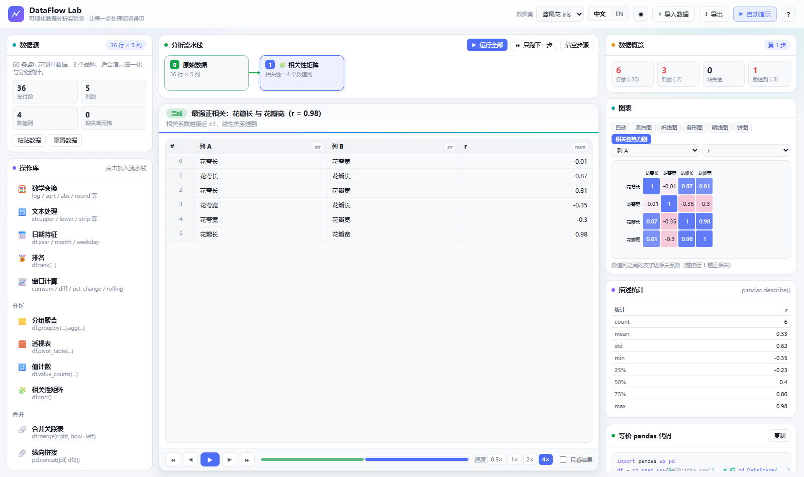
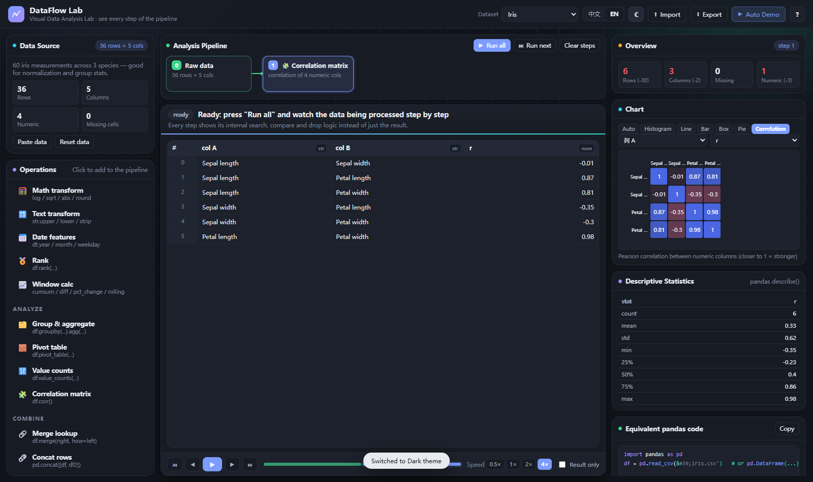

# DataFlow Lab · 关键亮点说明文档

> 数据可视化作业 · 数据分析展示
> 网站名称：**DataFlow Lab（可视化数据分析实验室）**
> 在线地址：<https://wangling1206.github.io/dataflow-lab/>
> 一句话定位：**把 pandas 的每一步处理「演」出来** —— 不止给结果，而是完整呈现数据从原始状态到处理完成的内部逻辑。

---

## 一、需求 → 实现对照

### 1.1 本轮追加的 5 项要求

| 追加要求 | 落实情况 |
|---|---|
| **① 图表过于单调，要多种可切换的呈现方式，并与分析联动** | 图表面板提供 **7 种图表**（直方图 / 折线 / 散点 / 条形 / 箱线 / 饼图 / 相关性热力图）+「自动」模式；字段（X / Y）可自由切换；**自动模式会跟随当前步骤**：当前步骤在处理哪一列，图表就展示哪一列；`分组聚合 / 透视表 / 值计数` 之后自动切柱状图，`相关性矩阵` 之后自动切热力图 |
| **② 原生支持中英文切换，两种语言内容一致** | 自研 `i18n` 体系，**同一套 key 驱动全站文案**：界面文案、28 个操作名与说明、参数名与选项、每一步的解说词、HUD 探针标签、提示消息、**数据集名称与说明、表头列名、以及单元格里的文本数据（姓名 / 班级 / 品类 / 品种…）**全部中英一致；切换语言后流水线用列 key 重新计算，结果与动画完全一致 |
| **③ 明暗主题切换 + 现代简约配色** | CSS 变量驱动的双主题（浅色 / 深色 + 跟随系统），顶栏一键切换并记忆；配色从原本的「深蓝黑」改为**中性灰 + 单一主色（靛蓝）**的现代简约风格：浅色为白底浅灰面板，深色为中性炭黑，仅用靛蓝 / 青绿 / 琥珀 / 玫红做数据语义色 |
| **④ 调整组件大小比例** | 三栏比例调整为 **292px ｜ 自适应 ｜ 384px**，顶栏压缩到 56px；舞台解说条 / 表格 / 播放条按 1 : 16 : 1 分配；图表区固定 196px、代码区 158px；右栏改为**整栏滚动**，描述统计不会再被挤压成 0 高度；窄屏自动降级为单列纵向布局 |
| **⑤ 实现 pandas 大部分功能，内容更丰富** | 操作库从 13 个扩展到 **28 个**，覆盖 `describe / melt / pivot_table / corr / merge / concat / rank / rolling / cumsum / diff / pct_change / astype / replace / value_counts / groupby.agg / drop_duplicates / dropna / fillna / ffill / bfill / interpolate / quantile / clip / str.* / dt.*` 等主流 API |

### 1.2 原始需求

| 原始要求 | 落实方式 |
|---|---|
| 能自由加载数据并处理 | ① 4 个内置数据集随时切换；② 本地导入 `.csv/.tsv/.txt/.json`；③ 弹窗**粘贴**数据；④ 处理结果可导出 CSV |
| 设定一个默认数据集 | 打开即载入「学生成绩 / Student Scores」（24 行 × 8 列，内含 2 个缺失值、1 组重复行、1 个超高分，便于演示清洗） |
| 参考 pandas 以可视化方式实现各种功能 | 28 个操作，每个都给出**等价 pandas 代码**（右侧面板可一键复制），代码随语言切换同步翻译列名 |
| 清晰呈现从原始到处理完成的每个步骤 | 顶部「分析流水线」串起 数据集 → 步骤 1 → 步骤 2 → …；每张步骤卡片显示参数摘要与执行状态（待运行 / 运行中脉冲 / 已完成 / 出错） |
| 每个步骤基于动态交互演示 | 可暂停、单步、回退、跳到结果、时间轴任意跳转、0.5×–4× 调速、「只看结果」瞬时模式 |
| **重点：去最大最小值要给出寻找逻辑与删除步骤** | 见「亮点 2」，HUD 探针实时显示「当前最小 / 当前最大 / 当前值」，标记随扫描移动，扫描结束后停位 → 标记 → 逐行删除 → 报告新区间 |
| 核心不是调用库直接出结果 | 全部计算由自研 `dataframe.js`（CSV 解析、类型推断、均值 / 中位数 / 标准差 / 分位数 / 皮尔逊相关 / describe / 转置式透视 / melt）完成，**零第三方依赖、零构建** |
| 动画般流畅、交互与展示自然衔接 | 统一设计令牌 + 统一缓动曲线；FLIP 重排、行坍缩、数字补间、扫描探针、图表生长动画 |

---

## 二、整体设计

```
┌────────────────── 顶栏：数据集 · 中/EN · 主题 · 导入 · 导出 · 自动演示 ──────────────────┐
├──────────────┬──────────────────────────────────────────────┬──────────────────────────┤
│ 数据源        │  分析流水线（步骤卡片 + 流动连接线）            │ 数据概览 KPI（带增减）     │
│ 操作库        │  ────────────────────────────────────────     │ 图表（7 种可切换）         │
│ 6 类 28 项    │  舞台：解说条 + 动画表格 + HUD 探针             │ 描述统计 describe()        │
│              │  ────────────────────────────────────────     │ 等价 pandas 代码           │
│              │  播放条：⏮ ◀ ▶ ▶ ⏭ · 时间轴 · 速度 · 只看结果   │ 本步变化量                 │
└──────────────┴──────────────────────────────────────────────┴──────────────────────────┘
   我要做什么  ←────────────────  正在发生什么  ────────────────→  结果是什么
```

---

## 三、十二个核心亮点

### 亮点 1｜每个操作产出「动画剧本」，而不是结果

`operations.js` 中每个操作 `run(df, params)` 返回的不是结果对象，而是一条**可播放的事件序列**：

```js
{
  df: <处理后的新数据>,
  code: "df = df.drop_duplicates(subset=['Name'], keep='first')",
  trace: [
    { t:'say',  key:'say.dedupe.start', args:{k:1}, badge:'run' },
    { t:'scan', mode:'rows', col:'name', items:[...], track:'flag', per:38, hud:true },
    { t:'say',  key:'say.dedupe.found', args:{d:1, keep:'first'}, badge:'core' },
    { t:'drop', ids:[...], labelKey:'drop.dup' },
    { t:'settle', mode:'render' }
  ]
}
```

播放器只认识事件类型（`say / scan / mark / drop / fill / addcol / removecol / rename / reorder / group / agg / settle / hud / wait`），
**新增一个数据处理操作 = 写一个 `run()`，完全不用碰动画代码**。这是整个项目最重要的架构决策，也是「28 个操作仍能保持一致动效」的原因。

*代码位置：`assets/js/operations.js`（生成剧本）、`assets/js/animator.js`（播放剧本）*

---

### 亮点 2｜「去除极值」把寻找逻辑演成一段推理过程

评委打分的经典需求：去掉一个最高分、一个最低分。多数可视化只会告诉你「删了 2 行」，本网站演示的是**怎么找到的**：

1. 表格右上浮出 **HUD 扫描探针**面板；
2. 逐格扫描整列，HUD 实时刷新 `扫描进度 / 当前最小 / 当前最大 / 当前值`；
3. 每发现更小的值，**蓝色标记从旧位置移动到新位置**；更大则红色标记移动；
4. 扫描结束，标记停在真正的极值上，解说同步报出「最小 57，最大 100」；
5. 极值行左侧亮起蓝 / 红色竖条，被标记为待删除目标；
6. 这些行依次淡出、右移、模糊、高度收拢，其余行自然上移；
7. 结论条给出「删除 2 行，剩余 22 行，新区间 62 ~ 95」。

同一操作还提供 **IQR 异常值剔除**（先讲 Q1 / Q3 / IQR / 正常区间，再逐行判定）与
**分位裁剪 clip**（不删行，越界数值平滑「滑」回边界）两种模式。


*图 2：扫描到第 24 行，HUD 显示「当前最小 57 / 当前最大 100」，蓝色标记停在最小值行、红色标记停在最大值行*

---

### 亮点 3｜稳定列 key + 稳定行 id，让双语与动画同时成立

- **列用 key 寻址**：每列是 `{ key, name, type }`，`key` 是语言无关的内部标识（`chinese` / `math`…），
  `name` 才是当前语言的显示名（语文 / Chinese）。
  步骤参数只存 key，因此**切换语言时重算整条流水线，参数、结果、动画全部保持有效**；派生列也用稳定 key（`total` / `petalL_norm` / `chinese_mean`）。
- **行有唯一 id**：删除 / 排序 / 分组聚合后视图仍能追踪「这一行去哪了」，因此可以实现
  **FLIP 重排**（先读新旧位置差，再反向位移过渡回 0）、**分组聚拢**、**坍缩聚合**（组内多行 `translate` 到组首并淡出）等精确动画。

*代码位置：`assets/js/dataframe.js`、`assets/js/tableview.js` 的 `flip() / collapseInto() / groupRow()`*

---

### 亮点 4｜28 个 pandas 操作，覆盖数据分析主流程

| 分类 | 操作 |
|---|---|
| 观察 (2) | 查看数据 `head/tail/sample`、统计摘要 `describe()` |
| 整理 (8) | 选择列、删除列、重命名列、条件筛选、排序、随机采样、类型转换 `astype`、宽表转长表 `melt` |
| 清洗 (5) | 去除重复、缺失值处理（`dropna/fillna/ffill/bfill/interpolate`）、去除极值（`nlargest/nsmallest/IQR/clip`）、值替换 `replace`、删除无用列（常数列 / 空列） |
| 变换 (7) | 新增计算列 `assign`、归一化 / 标准化、数学变换（`log/sqrt/abs/round/square`）、文本处理 `str.*`、日期特征 `dt.*`、排名 `rank`、窗口计算（`cumsum/diff/pct_change/rolling`） |
| 分析 (4) | 分组聚合 `groupby().agg()`、透视表 `pivot_table()`、值计数 `value_counts()`、相关性矩阵 `corr()` |
| 合并 (2) | 合并关联表 `merge()`（内置关联表，逐行查找匹配）、纵向拼接 `concat()`（内置补充表） |


*图 3：分组聚合完成 → 3 个班级坍缩成汇总行（总分均值 / 行数），右侧柱状图自动联动*

---

### 亮点 5｜7 种图表 + 「自动」模式，与分析步骤实时联动

| 图表 | 说明 | 联动规则 |
|---|---|---|
| 直方图 | 自适应分箱 + 均值虚线 | 数值列默认 |
| 折线图 | 按行序 / X 轴绘制趋势，描边动画 | 数值列 |
| 散点图 | 双数值列散点 + 自动标注相关系数 r | 需 ≥2 个数值列 |
| 条形图 | 类别聚合值（均值）/ 类别频数 | 分组聚合、透视、值计数后自动切换 |
| 箱线图 | 四分位箱体 + 须 + 异常点 | 数值列 |
| 饼图 | 取值占比（前 7 类 + 其他） | 类别列 |
| 相关性热力图 | 数值列两两皮尔逊相关，正蓝负粉 | 执行「相关性矩阵」后自动切换 |

「自动」模式会读取当前步骤的参数：**步骤在处理哪一列，图表就把哪一列推到前台**（例如归一化 `花瓣长` 时，图表 Y 轴自动切到该列）。


*图 4：鸢尾花数据集的 4×4 相关性热力图*

---

### 亮点 6｜中英双语，内容完全一致

- **同一套 key 驱动全站文案**：`assets/js/i18n.js`（通用词条）+ `assets/js/i18n-ext.js`（操作 / 解说 / 数据集词条）；
- **数据本身也双语**：数据集声明 `cols[].zh / cols[].en` 与 `rows / rowsEn` 两套数据，
  所以切到英文时表头变成 `ID / Name / Class / Chinese / Math`，单元格里的姓名、班级、性别、品类、品种也全部变成英文；
- **解说词也是 key**：动画剧本里只存 `say.dedupe.found` 这样的 key 与参数，播放时按当前语言渲染，
  因此**切换语言的瞬间，界面、操作库、参数面板、解说条、HUD、提示消息同时切换**，且流水线结果完全一致；
- **代码面板同步翻译**：`df.groupby('班级')` 会随语言变成 `df.groupby('Class')`。


*图 5：English + Dark 主题（界面、图表、代码、统计全部切换）*

---

### 亮点 7｜明暗双主题 + 现代简约配色

- **配色体系重构**：从「深蓝黑」改为**中性灰底 + 单一主色（靛蓝 #4f6ef7）**；
  数据语义色只保留 6 个（靛蓝 / 青绿 / 琥珀 / 玫红 / 紫 / 绿），浅色主题白底浅灰面板，深色主题中性炭黑（#101319，而非蓝黑）；
- **全部颜色走 CSS 变量**：`--surface / --border / --text / --accent / --c1..--c6`，
  JS 端（图表 SVG）通过 `getComputedStyle` 取色，主题切换后图表颜色同步刷新；
- 主题选择写入 `localStorage`，首次访问跟随系统 `prefers-color-scheme`；
- 支持 `prefers-reduced-motion`，此时动画降级为瞬时。

---

### 亮点 8｜可取消的异步播放引擎，节奏完全可控

播放器持有 `token`，所有等待都通过 `U.sleep(ms, token)`，补间动画时长也按速度系数缩放。
一旦用户**暂停 / 跳转 / 改参数 / 切数据集 / 切语言**，`token.cancel()` 立即打断动画链并清理定时器，
不会出现「动画还在跑但数据已经变了」的错位。

配套控制：速度 0.5× / 1× / 2× / 4×；「只看结果」瞬时模式；时间轴每一段可点击跳转；
步骤卡片显示 `待运行 / 运行中（脉冲）/ 已完成（绿序号）/ 出错（红色提示）`。

---

### 亮点 9｜数据引擎与统计全部自研，零依赖零构建

`dataframe.js` 实现 pandas 核心语义：CSV 解析（引号转义 / 分隔符嗅探 / 列名去重）、
缺失值语义（`''/NA/null/None/NaN/-/?` 统一识别，显示为红色 `⌀`）、类型推断、均值 / 中位数 / 样本标准差 /
任意分位数（线性插值）/ 皮尔逊相关 / `valueCounts` / `describe` / `corrMatrix` / 带 BOM 的 CSV 导出。

全部文件为经典 `<script>`，无模块化、无打包器，**双击 `index.html` 即可运行**，天然适配 GitHub Pages。

---

### 亮点 10｜智能默认参数与「自动演示」

- 默认参数会「读懂数据」：数值列优先选**非 id 类**字段；筛选阈值取该列**中位数**；
  去重默认**忽略主键列**；分组列选**取值数量接近 √n** 的类别列；图表选**方差最大**的数值列；
- 每个数据集都预置了一套贴合业务场景的流水线（`dataset.demo`），点击「自动演示」即按 1× 完整播放，
  配合解说条天然形成一份**带字幕的演示视频**：
  - 学生成绩：填缺失 → 去重 → 算总分 → 去极值 → 按班级聚合 → 排序
  - 门店销售：删缺失 → IQR 剔除异常销量 → 按品类求和 → 排序
  - 比赛评分：填缺失 → 去重 → 去极值 → 算均分 → 排序
  - 鸢尾花：归一化 → 相关性矩阵 → 按品种聚合 → 统计摘要

---

### 亮点 11｜组件比例与视觉节奏

- 三栏 **292 / 自适应 / 384**，顶栏 56px，刷新率优先让「舞台」占最大面积；
- 右栏改为整栏滚动 + 卡片固定高度，图表 196px、描述统计最长 268px、代码 158px，信息不再互相挤压；
- 表格行高 29px、最大高度动画收拢；字号层级 10.5 / 11.5 / 12.5 / 16px，紧凑但不拥挤；
- 窄屏（<1240px）自动单列堆叠，`<1480px` 收窄侧栏。

---

### 亮点 12｜交互细节

| 交互 | 反馈 |
|---|---|
| 点击操作库条目 | 步骤卡片弹入流水线并自动滚入视野，停在「该步骤之前」的状态，按 ▶ 即可单步观看 |
| 编辑步骤参数 | 立即从该步重算后续全部步骤，当前视图自动收敛到合法位置 |
| 悬停表格 | 表头类型徽标（`num / str`），缺失值红色 `⌀` 与虚化 |
| 悬停单元格 | 显示完整值 tooltip |
| 时间轴 | 点击任意一段跳到该步骤结果 |
| 快捷键 | `空格` 播放/暂停 · `←/→` 上/下一步 · `R` 运行全部 |
| 复制代码 | 一键复制当前进度的完整 pandas 脚本 |

---

## 四、数据分析功能清单（与 pandas 对照）

| 操作 | 等价 pandas |
|---|---|
| 查看数据 | `df.head(n)` / `df.tail(n)` / `df.sample(n, random_state=42)` |
| 统计摘要 | `df.describe()` |
| 选择列 / 删除列 | `df[[...]]` / `df.drop(columns=[...])` |
| 重命名列 | `df.rename(columns={...})` |
| 条件筛选 | `df[df[c] >= v]` / `.isna()` / `.notna()` / `.astype(str).str.contains()` |
| 排序 | `df.sort_values('c', ascending=False)` |
| 随机采样 | `df.sample(n=8, random_state=42)` |
| 类型转换 | `df['c'].astype('float' / 'str' / 'datetime64')` |
| 宽表转长表 | `df.melt(id_vars=[...], value_vars=[...])` |
| 去除重复 | `df.drop_duplicates(subset=[...], keep='first')` |
| 缺失值处理 | `df.dropna(subset=[...])` / `fillna(df[c].mean()/median()/mode()/0)` / `ffill()` / `bfill()` / `interpolate()` |
| 去除极值 | `df.drop(df[c].nlargest(n).index.union(df[c].nsmallest(n).index))` / IQR 区间过滤 / `df[c].clip(q05, q95)` |
| 值替换 | `df[c].replace(a, b)` |
| 删除无用列 | `cols = [c for c in df.columns if df[c].nunique(dropna=False) <= 1]; df.drop(columns=cols)` |
| 新增计算列 | `df['total'] = df[['chinese','math','english']].sum(axis=1)`（含 `mean/max/min/count` 与两列四则运算） |
| 归一化 / 标准化 | `(x-min)/(max-min)` / `(x-mean)/std` |
| 数学变换 | `np.log / np.sqrt / np.abs / np.round / np.square` |
| 文本处理 | `df[c].str.upper() / lower() / strip() / extract(r'\d+') / len()` |
| 日期特征 | `pd.to_datetime(df[c]).dt.year / month / day / weekday / quarter` |
| 排名 | `df[c].rank(ascending=False, method='min')` |
| 窗口计算 | `cumsum()` / `diff()` / `pct_change()` / `rolling(n).mean()` |
| 分组聚合 | `df.groupby('by')['c'].mean().reset_index()` |
| 透视表 | `df.pivot_table(index, columns, values, aggfunc).reset_index()` |
| 值计数 | `df[c].value_counts()`（含占比列） |
| 相关性矩阵 | `df.corr(numeric_only=True)`（并输出成对表 + 热力图） |
| 合并关联表 | `df.merge(right, on='key', how='left')` |
| 纵向拼接 | `pd.concat([df, extra], ignore_index=True)` |

---

## 五、性能与兼容

- **渲染上限**：表格最多渲染前 400 行以保证流畅，统计与计算仍走全量数据，界面明确提示；
- **动画自适应**：扫描步长随数据量夹紧（12–130ms），24 行明细清晰，36 行 iris 也不拖沓；
- **兼容性**：仅使用 ES2017 语法与 CSS 变量 / 过渡（无 `??=`、无顶层 await），Chrome / Edge / Firefox / Safari 现代版本均可直接运行；
- **体积**：全部资源约 250KB（不含演示视频），无外部 CDN、无字体下载，离线可用。

---

## 六、可扩展方向

1. 新增操作只需在 `operations.js` 增加一个 `run()`，UI 与播放器自动支持；
2. `trace` 是纯数据，可序列化成 JSON 做「流水线分享」（一条链接回放整套分析）；
3. 图表模块可继续扩展散点矩阵、箱线分组、时间序列分解等；
4. 可增加「两步对比视图」（左右并排原始 / 处理后），进一步强化前后差异。
