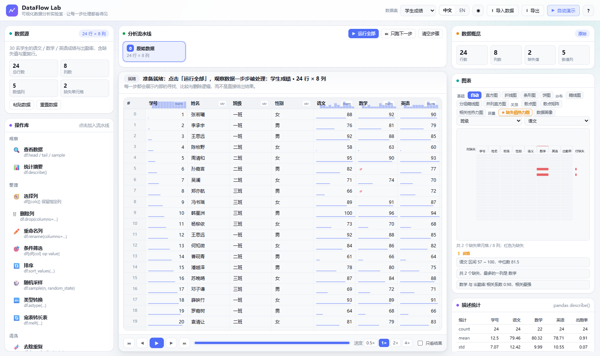
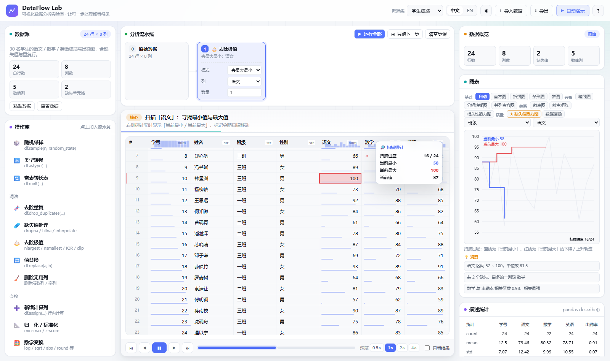
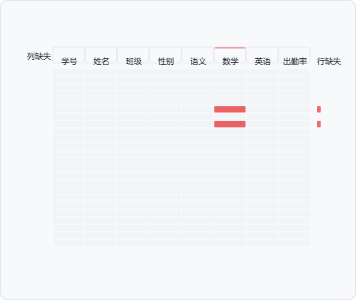
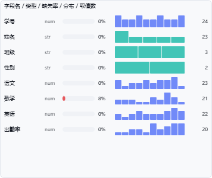
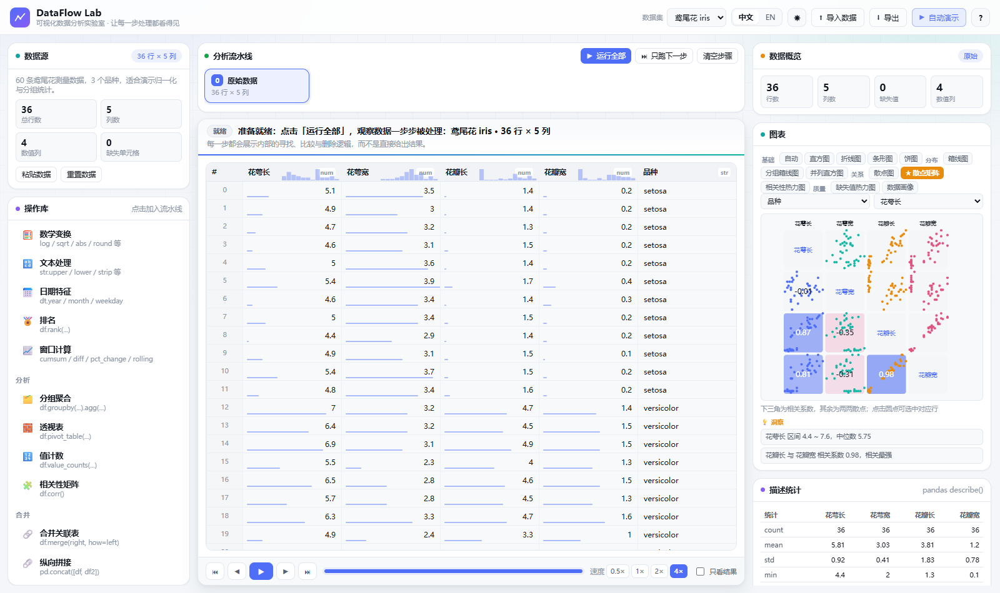
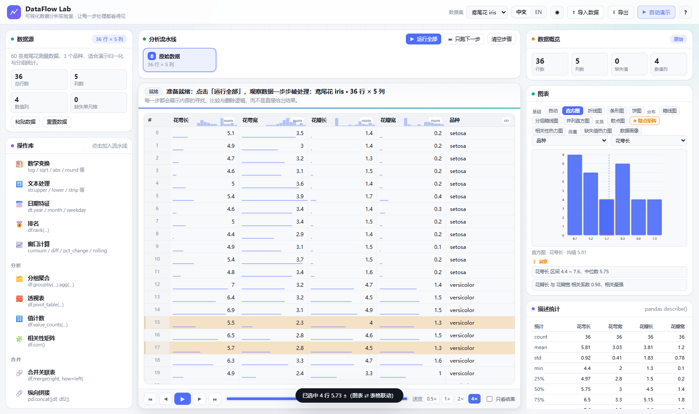
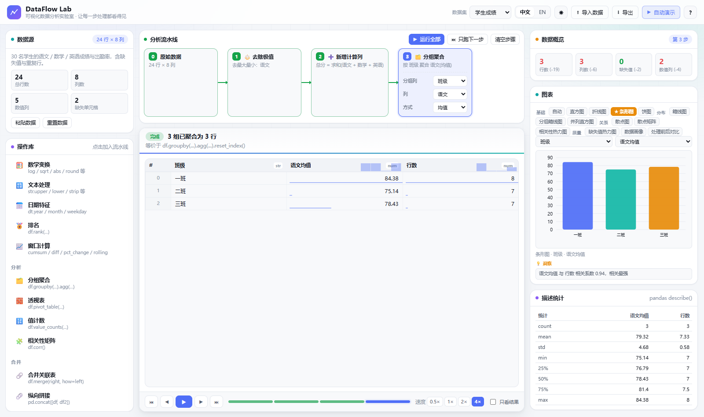
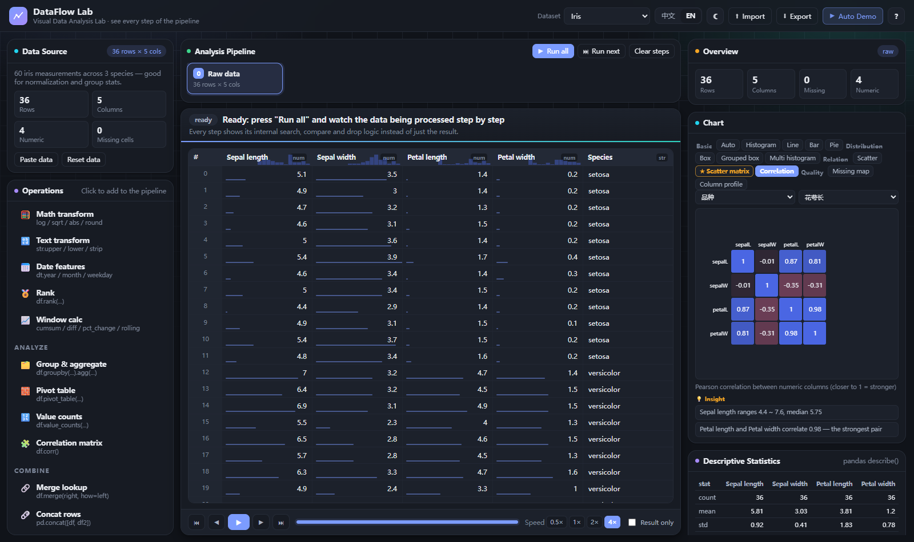

# DataFlow Lab · 关键亮点说明文档

> 数据可视化作业 · 数据分析展示
> 网站名称：**DataFlow Lab（可视化数据分析实验室）**
> 在线地址：<https://wangling1206.github.io/dataflow-lab/>
> 一句话定位：**把 pandas 的每一步处理「演」出来，并用图形把数据分析做深。**

---

## 一、需求 → 实现对照

### 1.1 最新要求：一定要采用可视化的方式，用图形增加数据分析的能力

这句话是本项目的**设计主线**。它包含四层含义，逐条落实如下：

| 含义 | 我们怎么做的 |
|---|---|
| **① 图形要能"发现问题"**（表格看不出来的：分布形态、离群点、相关关系、缺失模式、组间差异） | 图表扩展到 **14 种**，并新增「质量组」图表：**缺失值热力图**（缺失集中在哪一列、是否成片）、**数据画像**（每列的类型 / 缺失率 / 基数 / 分布迷你图）、**散点矩阵**（一眼找到强相关变量对）、**分组箱线图**（组间分布差异）、**并列直方图**（多列分布对比）、**处理前后对比**（这一步到底改变了什么）；同时给出**自动洞察**（偏度、离群点、最强相关对、缺失最多列…） |
| **② 图形要参与"分析过程"**，而不是只展示结果 | 扫描过程中图表**同步生长**：扫描一列时图表画出「当前最小」的下降轨迹与「当前最大」的上升轨迹；删除行时图形里的柱子"掉落"；填充时柱子长高。**静止的图表变成会呼吸的分析过程**（见图 2） |
| **③ 图形要能反向操作**（刷选联动） | **点击图元 → 表格高亮并滚动定位到对应行**（直方图柱、箱体、异常点、散点、饼图扇区、条形柱都能点）；**悬停表格行 → 图上对应图元高亮** |
| **④ 图形要内嵌到数据里**（不用来回切面板） | **表头内嵌分布迷你图**（sparkline）、**数值单元格内嵌数据条**（长度 = 该值在该列中的相对大小），扫一眼就能比较大小与形态 |

因此本项目的图表**不是"画出来的结果"，而是"用来分析的工具"**：它会提问（洞察）、会指路（刷选定位）、会演过程（实时生长）。

### 1.2 前几轮要求

| 要求 | 落实情况 |
|---|---|
| 图表多种可切换、与分析联动 | 14 种图表，按 **基础 / 分布 / 关系 / 质量** 四组排列；「自动」模式会**根据当前数据推荐最合适的图**（★ 标记），并跟随当前步骤的字段联动 |
| 原生中英双语、内容一致 | 自研 i18n：界面、28 个操作、参数、解说、HUD、数据集名称与说明、**表头列名与单元格文本数据**、生成的 pandas 代码、**新增的图表名与洞察文案**全部双语一致 |
| 明暗主题 + 现代简约配色 | CSS 变量双主题，中性灰底 + 单一靛蓝主色；图表 SVG 通过 `getComputedStyle` 取色，主题切换后同步刷新 |
| 调整组件比例 | 三栏 **292 / 自适应 / 384**；右栏整栏滚动；图表 224px（矩阵型图表自动升到 300px）；表头加迷你图、单元格加数据条后仍保持 29px 行高 |
| 实现 pandas 大部分功能 | **28 个操作**，覆盖 `describe / melt / pivot_table / corr / merge / concat / rank / rolling / cumsum / diff / pct_change / astype / replace / value_counts / groupby.agg / drop_duplicates / dropna / fillna / ffill / bfill / interpolate / quantile / clip / str.* / dt.*` |

### 1.3 原始需求

| 原始要求 | 落实方式 |
|---|---|
| 自由加载数据 | 4 个内置数据集 + 本地导入（csv/tsv/txt/json）+ 粘贴数据 + 导出 CSV |
| 默认数据集 | 打开即载入「学生成绩 / Student Scores」（24 行 × 8 列，含 2 个缺失值、1 组重复行、1 个超高分） |
| 参考 pandas 可视化实现各种功能 | 28 个操作，每个都给出**等价 pandas 代码**（可一键复制） |
| 清晰呈现每个步骤 | 顶部流水线串起 数据集 → 步骤 1 → …，每张卡片显示参数摘要与执行状态 |
| 每个步骤动态交互演示 | 暂停 / 单步 / 回退 / 跳转 / 0.5×–4× /「只看结果」 |
| **重点：去最大最小值要给出寻找逻辑与删除步骤** | 表格探针扫描 + **图表同步画出 running min / running max 轨迹** + HUD 实时数值 + 标记移动 + 逐行删除（见图 2） |
| 核心不是调用库直接出结果 | 自研 `dataframe.js`（CSV 解析、类型推断、均值/中位数/标准差/分位数/皮尔逊相关/describe/相关矩阵）；**零第三方依赖、零构建** |

---

## 二、整体设计

```
┌──────────────── 顶栏：数据集 · 中/EN · 主题 · 导入 · 导出 · 自动演示 ─────────────────┐
├──────────────┬────────────────────────────────────────────┬──────────────────────────┤
│ 数据源        │  分析流水线（步骤卡片 + 流动连接线）            │ 数据概览 KPI（带增减）      │
│ 操作库        │  ──────────────────────────────────────      │ 图表 14 种（可切/可点选）    │
│ 6 类 28 项    │  舞台：解说条 + 动画表格 + HUD 探针             │ ├ 自动洞察（从图里读出结论）  │
│              │  （表头 sparkline / 单元格数据条）             │ 描述统计 describe()        │
│              │  ──────────────────────────────────────      │ 等价 pandas 代码            │
│              │  播放条：⏮ ◀ ▶ ▶| ⏭ · 时间轴 · 速度 · 只看结果  │ 本步变化量                  │
└──────────────┴────────────────────────────────────────────┴──────────────────────────┘
   我要做什么  ←──────────  正在发生什么  ──────────→  结果是什么 / 看出了什么
```


*图 1：默认数据集「学生成绩」——左侧 28 个操作、中间流水线与动画表格、右侧 KPI / 图表 / 洞察 / 统计 / 代码。注意表头右上角的分布迷你图与单元格底部的数据条*

---

## 三、核心亮点

### 亮点 1｜图表参与分析过程：把「统计量是怎么形成的」画出来

传统可视化是"步骤跑完 → 换一张新图"。我们的图表在扫描过程中**实时生长**：

- 扫描一列时，图表画出 **当前最小值的下降阶梯线（蓝）** 与 **当前最大值的上升阶梯线（红）**，
  同时保留原始值折线作为背景，并用圆点标记当前扫描到的值；
- 图内直接标注「当前最小 58 / 当前最大 100」与「扫描进度 16/24」；
- 判定型扫描（筛选 / 去重 / IQR）则显示 **保留 / 剔除** 两条计数条的实时增长；
- 删除时图表重新布局，被删掉的行从分布里"掉出"；填充时对应柱子长高。

这样"最大值是怎么被找到的"不再是一个结论，而是**一条可以看着它下降/上升的曲线**。


*图 2：扫描到第 16 行时，红色阶梯线已经把「当前最大」推到 100，蓝色阶梯线把「当前最小」压到 58；表格中 韩星洲(100) 被标红、傅明澈(57) 被标蓝*

---

### 亮点 2｜14 种图表：从"画结果"到"用图形问问题"

| 分组 | 图表 | 回答什么问题 |
|---|---|---|
| 基础 | 自动 / 直方图 / 折线 / 条形 / 饼图 | 这一列的分布形态？趋势？各类占比？ |
| 分布 | 箱线图 / **分组箱线图** / **并列直方图** | 有没有离群点？**各组分布差异有多大**？多列分布怎么比？ |
| 关系 | 散点图 / **散点矩阵** / 相关性热力图 | 两两关系？**哪些变量强相关**？ |
| 质量 | **缺失值热力图** / **数据画像** / **处理前后对比** | 缺失在哪、是否成片？每列质量如何？**这一步改变了什么**？ |

- **★ 智能推荐**：根据当前数据自动推荐最合适的一张图（有缺失 → 缺失值热力图；≥3 个数值列 → 散点矩阵；类别 + 数值 → 分组箱线图…）；
- **字段联动**：X / Y 可自由切换；「自动」模式下图表会跟着**当前步骤正在处理的那一列**走；
- 矩阵型图表会自动把画布从 224px 升到 300px 保证可读性。


*图 3：缺失值热力图——上排为列缺失率，右侧为行缺失率，红色即缺失*


*图 4：数据画像——每列一行：类型 / 缺失率条 / 分布迷你图 / 取值数量*


*图 5：散点矩阵（鸢尾花）——下三角是相关系数（0.96、0.87…），其余是两两散点，一眼看出哪些变量强相关*

---

### 亮点 3｜图形驱动分析：刷选联动 + 自动洞察

- **图 → 表**：点击直方图的柱子、箱线图的箱体或异常点、散点图的点、饼图扇区、条形图的柱，
  表格会**高亮并自动滚动定位**到对应的数据行（并提示"已选中 N 行"）；
- **表 → 图**：鼠标悬停在表格某一行，图中包含该行的图元会高亮；
- **异常点即入口**：箱线图上的异常圆点直接对应"那一行"，点击即可定位到具体记录；
- **自动洞察**：图表下方自动给出最多 3 条"从图形读出来的结论"，例如
  「语文 区间 57 ~ 100，中位数 81.5」「共 2 个缺失，最多的一列是 数学」「数学 与 出勤率 相关系数 0.98，相关最强」
  「有 1 列取值恒定，可考虑删除」。


*图 6：点击直方图的一根柱子，表格中被选中的行整体高亮*

---

### 亮点 4｜把图"塞进"表格：表头迷你图 + 单元格数据条

- **表头 sparkline**：每个数值列的列名右上角内嵌一条分布迷你直方图，不用点开图表就知道这一列是偏态还是双峰；
- **单元格数据条**：数值单元格底部有一条长度与数值大小成正比的细条（相对该列的 min–max），
  一眼看出谁高谁低，比读数字快得多；
- 两者都纯 CSS/SVG 实现，不增加行高，不影响原有动画（探针 / 标记 / 删除 / 坍缩）。

---

### 亮点 5｜每个操作产出「动画剧本」，而不是结果

`operations.js` 中每个操作 `run(df, params)` 返回一条**可播放的事件序列**：

```js
{
  df: <处理后的新数据>,
  code: "df = df.drop_duplicates(subset=['姓名'], keep='first')",
  trace: [
    { t:'say',  key:'say.dedupe.start', args:{k:1}, badge:'run' },
    { t:'scan', mode:'rows', col:'name', items:[...], track:'flag', per:38, hud:true },
    { t:'say',  key:'say.dedupe.found', args:{d:1}, badge:'core' },
    { t:'drop', ids:[...], labelKey:'drop.dup' },
    { t:'settle', mode:'render' }
  ]
}
```

播放器只认识事件类型（`say / scan / mark / drop / fill / addcol / removecol / rename / reorder / group / agg / settle / hud / wait`）。
**新增操作 = 写一个 `run()`**，动画、界面、双语、图表都会自动支持——这也是 28 个操作仍能保持统一动效的原因。

---

### 亮点 6｜「去除极值」把寻找逻辑演成一段推理过程

1. 表格逐格扫描 + 图表同步画轨迹 + HUD 实时刷新 `进度 / 当前最小 / 当前最大 / 当前值`；
2. 标记随扫描**移动**，扫描结束停在真正的极值上；
3. 极值行左侧亮起蓝 / 红竖条，被标记为待删除目标；
4. 依次淡出、右移、模糊、高度收拢，其余行自然上移；图表里的柱子同步"掉落"；
5. 结论条给出「删除 2 行，剩余 22 行，新区间 58 ~ 95」。
6. 另有 **IQR 异常值剔除**（先讲 Q1/Q3/IQR/正常区间，再逐行判定）与 **分位裁剪 clip**（不删行，越界值滑回边界）。

---

### 亮点 7｜28 个 pandas 操作，覆盖数据分析主流程

| 分类 | 操作 |
|---|---|
| 观察 (2) | 查看数据 `head/tail/sample`、统计摘要 `describe()` |
| 整理 (8) | 选择列、删除列、重命名列、条件筛选、排序、随机采样、类型转换 `astype`、宽表转长表 `melt` |
| 清洗 (5) | 去除重复、缺失值处理（`dropna/fillna/ffill/bfill/interpolate`）、去除极值（`nlargest/nsmallest/IQR/clip`）、值替换 `replace`、删除无用列 |
| 变换 (7) | 新增计算列 `assign`、归一化/标准化、数学变换（`log/sqrt/abs/round/square`）、文本处理 `str.*`、日期特征 `dt.*`、排名 `rank`、窗口计算（`cumsum/diff/pct_change/rolling`） |
| 分析 (4) | 分组聚合 `groupby().agg()`、透视表 `pivot_table()`、值计数 `value_counts()`、相关性矩阵 `corr()` |
| 合并 (2) | 合并关联表 `merge()`（内置关联表）、纵向拼接 `concat()`（内置补充表） |


*图 7：分组聚合完成 → 3 个班级坍缩成汇总行（总分均值 / 行数），图表自动联动为按班级的柱状图*

---

### 亮点 8｜中英双语，内容完全一致

- **同一套 key 驱动全站**：`i18n.js`（通用）+ `i18n-ext.js`（操作/解说/数据集）+ 图表名与洞察词条；
- **数据本身也双语**：数据集声明 `cols[].zh / cols[].en` 与 `rows / rowsEn` 两套数据，
  切到英文后表头变成 `ID / Name / Class / Chinese / Math`，单元格里的姓名、班级、性别、品类、品种同步翻译；
- **解说与洞察也是 key**：动画剧本只存 key + 参数，播放时按当前语言渲染；
- **代码面板同步**：`df.groupby('班级')` → `df.groupby('Class')`。


*图 8：English + Dark 主题（界面、图表、代码、统计全部切换）*

---

### 亮点 9｜明暗主题 + 现代简约配色

中性灰底 + 单一主色（靛蓝 #4f6ef7）；浅色为白底浅灰面板，深色为中性炭黑（#101319，而非蓝黑）；
数据语义色只保留 6 个；所有颜色走 CSS 变量，JS 端图表通过 `getComputedStyle` 取值，主题切换后图表颜色同步刷新；
主题写入 `localStorage`，首访跟随系统 `prefers-color-scheme`；支持 `prefers-reduced-motion`。

---

### 亮点 10｜可取消的异步播放引擎

播放器持有 `token`，所有等待与补间都按速度系数缩放。暂停 / 跳转 / 改参数 / 切语言 / 切数据集都会
`token.cancel()` 立即打断动画链并清理状态，不会出现"动画还在跑但数据已经变了"的错位。

---

### 亮点 11｜零依赖的数据引擎与统计

`dataframe.js`：CSV 解析（引号转义 / 分隔符嗅探 / 列名去重）、缺失值语义（`''/NA/null/None/NaN/-/?`）、
类型推断（`number / date / string`）、均值 / 中位数 / 样本标准差 / 任意分位数（线性插值）/ 皮尔逊相关 /
`valueCounts` / `describe` / `corrMatrix` / 带 BOM 的 CSV 导出。全部文件为经典 `<script>`，**双击 `index.html` 即可运行**。

---

### 亮点 12｜智能默认与一键自动演示

- 默认参数"懂数据"：数值列优先非 id 字段、筛选阈值取中位数、去重忽略主键列、分组列取 √n 附近基数、图表取方差最大的列；
- 每个数据集预置贴合业务的流水线，点「自动演示」按 1× 完整播放（含解说条），天然形成一份带字幕的演示视频。

---

## 四、操作与 pandas 对照表

| 操作 | 等价 pandas |
|---|---|
| 查看数据 | `df.head(n)` / `df.tail(n)` / `df.sample(n, random_state=42)` |
| 统计摘要 | `df.describe()` |
| 选择列 / 删除列 | `df[[...]]` / `df.drop(columns=[...])` |
| 重命名列 | `df.rename(columns={...})` |
| 条件筛选 | `df[df[c] >= v]` / `.isna()` / `.notna()` / `.astype(str).str.contains()` |
| 排序 | `df.sort_values('c', ascending=False)` |
| 随机采样 | `df.sample(n=8, random_state=42)` |
| 类型转换 | `df['c'].astype('float' / 'str' / 'datetime64')` |
| 宽表转长表 | `df.melt(id_vars=[...], value_vars=[...])` |
| 去除重复 | `df.drop_duplicates(subset=[...], keep='first')` |
| 缺失值处理 | `dropna` / `fillna(mean/median/mode/0)` / `ffill` / `bfill` / `interpolate` |
| 去除极值 | `nlargest(n) ∪ nsmallest(n)` / IQR 区间过滤 / `clip(q05, q95)` |
| 值替换 | `df[c].replace(a, b)` |
| 删除无用列 | 常数列 / 全空列 → `df.drop(columns=cols)` |
| 新增计算列 | `df[['a','b']].sum(axis=1)` 等（sum/mean/max/min/count/四则） |
| 归一化 / 标准化 | `(x-min)/(max-min)` / `(x-mean)/std` |
| 数学变换 | `np.log / np.sqrt / np.abs / np.round / np.square` |
| 文本处理 | `str.upper/lower/strip/extract(r'\d+')/len` |
| 日期特征 | `pd.to_datetime(...).dt.year/month/day/weekday/quarter` |
| 排名 | `df[c].rank(ascending=False, method='min')` |
| 窗口计算 | `cumsum()` / `diff()` / `pct_change()` / `rolling(n).mean()` |
| 分组聚合 | `df.groupby('by')['c'].mean().reset_index()` |
| 透视表 | `df.pivot_table(index, columns, values, aggfunc)` |
| 值计数 | `df[c].value_counts()` |
| 相关性矩阵 | `df.corr(numeric_only=True)` |
| 合并关联表 | `df.merge(right, on='key', how='left')` |
| 纵向拼接 | `pd.concat([df, extra], ignore_index=True)` |

---

## 五、交互细节清单

| 交互 | 反馈 |
|---|---|
| 点击操作库条目 | 步骤卡片弹入流水线并自动滚入视野，停在"该步骤之前"的状态，按 ▶ 单步观看 |
| 编辑步骤参数 | 立即从该步重算后续全部步骤 |
| 点击图元 | 表格高亮 / 滚动定位到对应行 |
| 悬停表格行 | 图中对应图元高亮 |
| 悬停单元格 | 显示完整值 tooltip；缺失值显示红色 `⌀` |
| 时间轴 | 点击任意一段跳到该步骤结果 |
| 快捷键 | `空格` 播放/暂停 · `←/→` 上/下一步 · `R` 运行全部 |
| 复制代码 | 一键复制当前进度的完整 pandas 脚本 |

---

## 六、性能与兼容

- 表格最多渲染前 400 行（统计与计算仍走全量数据，界面有提示）；缺失图最多画 60 行 × 全部列；
- 扫描期间图表**节流刷新**（每 2 项一次）并限制矩阵/画像列数，保证 60fps；
- 仅使用 ES2017 语法与 CSS 变量/过渡，Chrome / Edge / Firefox / Safari 现代版本均可直接运行；
- 全部资源约 300KB（不含视频），无外部 CDN、无字体下载，离线可用。

---

## 七、可扩展方向

1. 新增操作只需写一个 `run()`；新增图表只需实现一个 `draw*()`；
2. `trace` 是纯数据，可序列化成 JSON 做「流水线分享」（一条链接回放整套分析）；
3. 图元已带 `data-ids`，可继续扩展"框选刷选（矩形选择）""点击异常点直接生成清洗步骤"等图形驱动操作；
4. 洞察规则可继续扩充（分组方差分析、时间序列趋势、类别不平衡提示等）。
